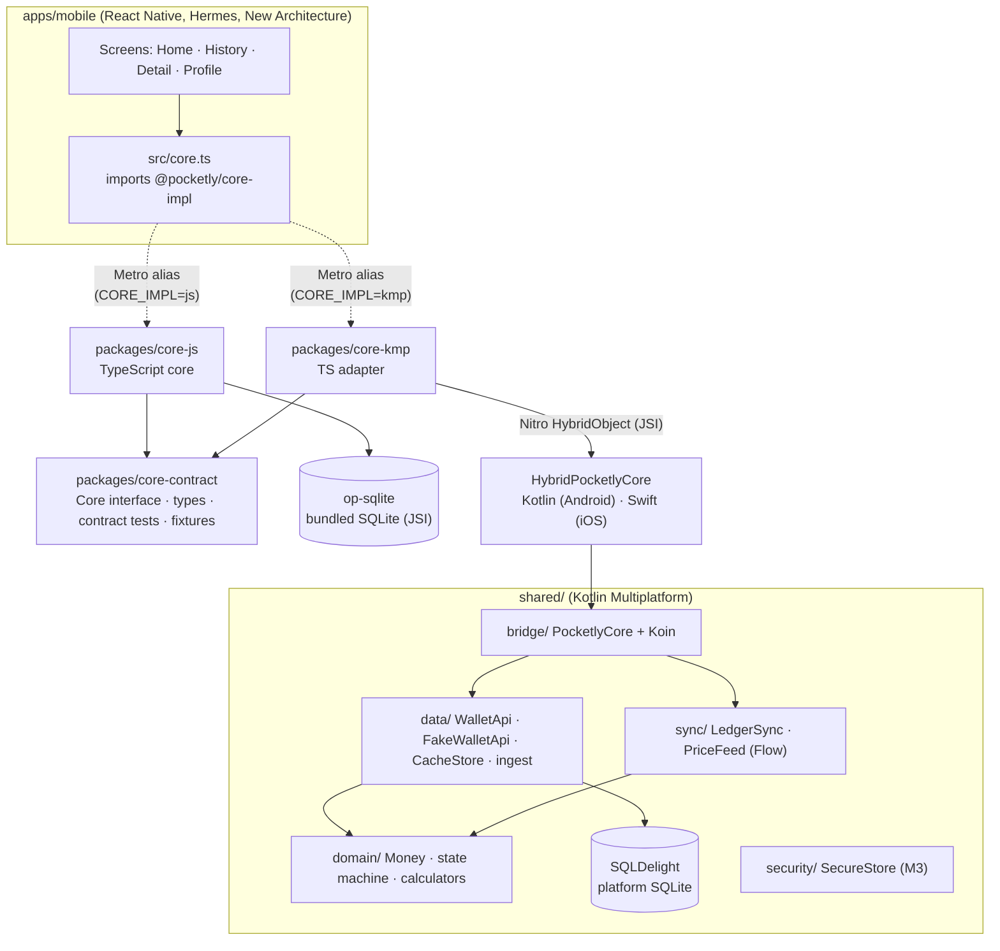
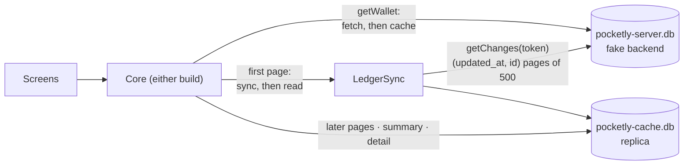

# Architecture

Pocketly is **one React Native app with two interchangeable business cores**. The UI only
knows the `Core` interface; which implementation it gets is decided at build time.



## Packages

| Path | Role | Imports allowed |
|---|---|---|
| `packages/core-contract` | `Core` interface, all bridged types, error codes, the contract test suite and parity fixtures | nothing |
| `packages/core-js` | The `jsCore` implementation, in TypeScript. Stores data with op-sqlite | `core-contract`, `@op-engineering/op-sqlite` |
| `packages/core-kmp` | The `kmpCore` implementation: Nitro spec, a TS adapter, Kotlin and Swift adapters | `core-contract`, `react-native-nitro-modules` |
| `packages/native-preferences` | UI preferences shared by both builds (ADR-0005), on SharedPreferences / NSUserDefaults | — |
| `shared/` | The KMP module that holds all `kmpCore` business logic | — |
| `apps/mobile` | The RN app. Screens import `src/core.ts` and `core-contract` types, never a specific core | `core-contract`, `@pocketly/core-impl` (virtual) |

## Layers (same shape in both cores)

| Layer | Kotlin (`shared/src/commonMain/.../shared/`) | TypeScript (`packages/core-js/src/`) |
|---|---|---|
| `domain/` (pure, depends on nothing) | `Money`, `MoneyFormatter`, `TransferStateMachine`, `UtcCalendar`, `Ledger`, `SpendingCalculator` | `money`, `transferStateMachine`, `calendar`, `ledger`, `spendingSummary` |
| `data/` | `WalletApi`, `TimeoutWalletApi` (NFR-REL-01), `CacheStore` (the replica), `db/` (drivers, row mapping), `fake/FakeWalletApi`, `fake/ServerStore`, `fake/NetworkSimulator` (F11), `fake/SeedData`, `fake/SeededRandom`, `TransactionDtoValidator`, `TransactionIngestor`, `UserTimeZone` | same names in camelCase; `db/` also holds `sql.generated.ts` |
| `sync/` | `LedgerSync` (server → replica), `PriceFeed` (exposes a `Flow`) | `ledgerSync`, `priceFeed` |
| `security/` | `SecureStore` (interface; Keystore/Keychain `actual`s come in M3) | — (the JS build will call the same native secure storage) |
| `bridge/` | `PocketlyCore` facade, `BridgeConversions`, `di/CoreModule` (Koin) | `jsCore.ts` (composition root) |

Each Kotlin file names the TS file it mirrors, and vice versa. BM-PAR-02 ("same algorithms")
is enforced by review plus the cross-language fixture tests.

## Storage (ADR-0009)

Each core keeps two SQLite files: `pocketly-server.db`, the fake backend's truth, and
`pocketly-cache.db`, the app's full local replica. Both have the same schema in both cores:
the SQLDelight `.sq` files (`shared/src/commonMain/sqldelight/`) are the source, and
`yarn sql:generate` writes them into `core-js/src/data/db/sql.generated.ts` (`yarn sql:check`
in CI catches drift).



- **Reads come from the replica.** The first page of `getTransactions()` syncs the ledger
  delta into the replica first; `getWallet()` fetches the wallet and caches it. Later pages,
  the spending summary and `getTransaction()` read only the replica, so pagination is stable
  mid-scroll (cursor = `(createdAt, id)`) and works offline.
- **Offline fallback.** If the sync or the wallet fetch fails with `NETWORK_UNAVAILABLE`, `NETWORK_TIMEOUT` or
  `SERVER_ERROR`, the read is answered from the replica with `stale: { reason, cachedAt }`.
  The screens show it as a banner with "Last updated hh:mm". With nothing cached, the error
  is passed on.
- **Engines differ** (BM-PAR-03): `core-js` uses op-sqlite, which bundles its own SQLite;
  `shared/` uses SQLDelight on the platform's SQLite (Android framework, iOS `libsqlite3`).
  `kmpCore` never ships op-sqlite: Android excludes its package and strips its `.so`, iOS doesn't link the pod.
  Timings keep storage apart: `lastStorageMs()` next to `lastComputeMs()`.
- Jest runs `core-js` (and the app's tests) on Node's built-in `node:sqlite`, and the JVM tests run on SQLDelight's JDBC driver.

## The app

`apps/mobile` has one React Navigation native stack: `Tabs` (a custom tab bar over Home,
History and Profile) with `TransactionDetail` pushed above it. Detail lives on the root stack
rather than in a per-tab stack so Android's Back always goes to the screen on top. Home and
History stay mounted once visited, so their state and scroll position survive tab switches.
History uses FlashList with day headers that stick while scrolling; a page append is applied only if no newer
request has replaced the list (ADR-0007).

Perf builds read benchmark **launch arguments** (`pocketly.*` intent extras → the root
`launchArgs` prop → `src/launchArgs.ts`) and apply them before the first screen loads.
See [benchmarking.md](benchmarking.md) §5.3.

## How the build picks a core

| | jsCore | kmpCore |
|---|---|---|
| Android flavor | `jsCore` → `com.pocketly.js` | `kmpCore` → `com.pocketly.kmp` |
| JS bundle | `@pocketly/core-impl` → `core-js` | `@pocketly/core-impl` → `core-kmp` (`metro.kmp.config.js`) |
| Native | no core code | `:pocketly_core-kmp` + `com.pocketly:pocketly-shared` (`kmpCoreImplementation`) |
| Storage | op-sqlite (`libop-sqlite.so`) | SQLDelight on the platform SQLite (op-sqlite excluded) |
| iOS | `pod install` | `CORE_IMPL=kmp pod install` (links `PocketlyCoreKmp` + the XCFramework) |

Android build types: `debug` (Metro), `release`, and `perf`, which is `release` plus launch
arguments for benchmark runs.

Neither build contains the other core's code. The release bundles have been checked for this,
and so have the APK native libraries: `libPocketlyCoreKmp.so` is in `kmpCore` only. See
[ADR-0003](adr/0003-linking-and-build-selection.md) for one known exception, the Nitro runtime.

## Parity (BM-PAR-01)

```
packages/core-contract/fixtures/
  money.json          hand-written ─┐
  state-machine.json  hand-written  ├─▶ Jest: runContractSuite(core-js)          (packages/core-js/__tests__)
  ingest.json         hand-written  │
  golden.json         generated ────┴─▶ JUnit: ContractFixturesTest(PocketlyCore) (shared/src/jvmTest)
```

`golden.json` is generated from `core-js` (`yarn contract:golden`) and checked in. The Kotlin
suite asserts against the same file, so if the two cores disagree, one of the suites fails.
