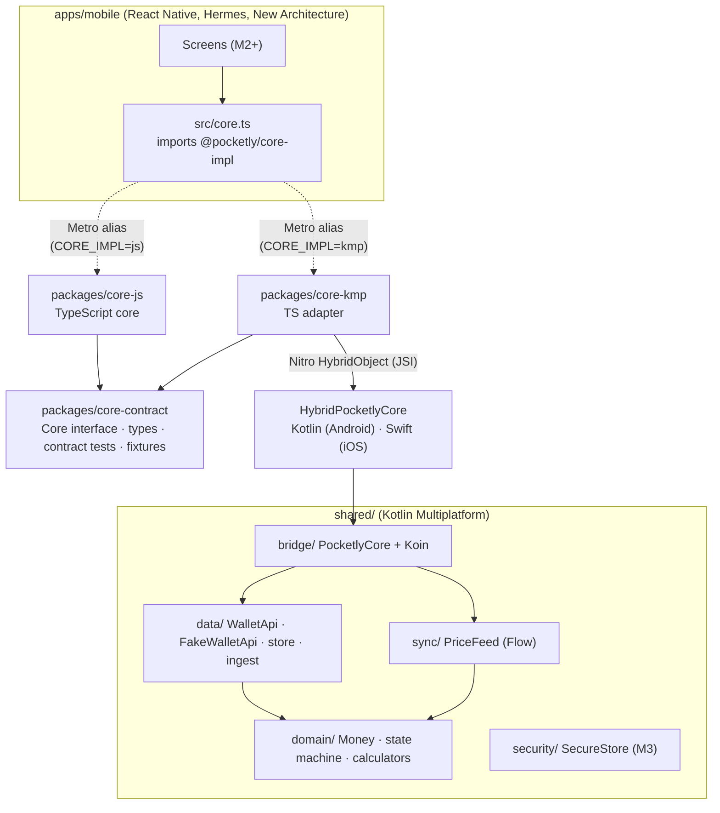

# Architecture

Pocketly is **one React Native app with two interchangeable business cores**. The UI only
knows the `Core` interface; which implementation it gets is decided at build time.



## Packages

| Path | Role | Imports allowed |
|---|---|---|
| `packages/core-contract` | `Core` interface, all bridged types, error codes, the contract test suite and parity fixtures | nothing |
| `packages/core-js` | The `jsCore` implementation, in TypeScript | `core-contract` |
| `packages/core-kmp` | The `kmpCore` implementation: Nitro spec, a TS adapter, Kotlin and Swift adapters | `core-contract`, `react-native-nitro-modules` |
| `shared/` | The KMP module that holds all `kmpCore` business logic | — |
| `apps/mobile` | The RN app. Screens import `src/core.ts` and `core-contract` types, never a specific core | `core-contract`, `@pocketly/core-impl` (virtual) |

## Layers (same shape in both cores)

| Layer | Kotlin (`shared/src/commonMain/.../shared/`) | TypeScript (`packages/core-js/src/`) |
|---|---|---|
| `domain/` (pure, depends on nothing) | `Money`, `MoneyFormatter`, `TransferStateMachine`, `UtcCalendar`, `Ledger`, `SpendingCalculator` | `money`, `transferStateMachine`, `calendar`, `ledger`, `spendingSummary` |
| `data/` | `WalletApi`, `fake/FakeWalletApi`, `fake/SeedData`, `fake/SeededRandom`, `TransactionStore`, `TransactionDtoValidator`, `TransactionIngestor` | same names in camelCase |
| `sync/` | `PriceFeed` (exposes a `Flow`) | `priceFeed` |
| `security/` | `SecureStore` (interface; Keystore/Keychain `actual`s come in M3) | — (the JS build will call the same native secure storage) |
| `bridge/` | `PocketlyCore` facade, `BridgeConversions`, `di/CoreModule` (Koin) | `jsCore.ts` (composition root) |

Each Kotlin file names the TS file it mirrors, and vice versa. BM-PAR-02 ("same algorithms")
is enforced by review plus the cross-language fixture tests.

## How the build picks a core

| | jsCore | kmpCore |
|---|---|---|
| Android flavor | `jsCore` → `com.pocketly.js` | `kmpCore` → `com.pocketly.kmp` |
| JS bundle | `@pocketly/core-impl` → `core-js` | `@pocketly/core-impl` → `core-kmp` (`metro.kmp.config.js`) |
| Native | no core code | `:pocketly_core-kmp` + `com.pocketly:pocketly-shared` (`kmpCoreImplementation`) |
| iOS | `pod install` | `CORE_IMPL=kmp pod install` (links `PocketlyCoreKmp` + the XCFramework) |

Neither build contains the other core's code. The release bundles have been checked for this,
and so have the APK native libraries: `libPocketlyCoreKmp.so` is in `kmpCore` only. See
[ADR-0003](adr/0003-linking-and-build-selection.md) for one known exception, the Nitro runtime.

## Parity (BM-PAR-01)

```
packages/core-contract/fixtures/
  money.json          hand-written ─┐
  state-machine.json  hand-written  ├─▶ Jest: runContractSuite(core-js)          (packages/core-js/__tests__)
  ingest.json         hand-written  │
  golden.json         generated ────┴─▶ JUnit: ContractFixturesTest(PocketlyCore) (shared/src/jvmTest)
```

`golden.json` is generated from `core-js` (`yarn contract:golden`) and checked in. The Kotlin
suite asserts against the same file, so if the two cores disagree, one of the suites fails.
